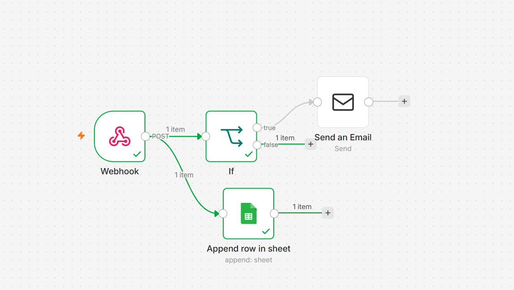

# 🏠 ImmoLead AI — Intelligent Lead Qualification

> Automatisation de la qualification de prospects immobiliers avec Python, LLM local et n8n.

## 📌 Présentation

**ImmoLead AI** est une application permettant d'automatiser la qualification de prospects immobiliers à partir de leurs messages.

Le système analyse le message d'un prospect à l'aide d'un **LLM local exécuté avec Ollama**, extrait les informations importantes, puis attribue automatiquement un **score de qualification sur 100** et un niveau de priorité.

Les leads peuvent ensuite être transmis à un workflow **n8n** afin d'automatiser leur traitement, notamment leur enregistrement dans Google Sheets et l'envoi d'un email selon certaines conditions.

---

## 🎯 Objectifs

Le projet permet de :

- 📝 Analyser le message d'un prospect
- 🤖 Extraire automatiquement les informations importantes avec un LLM
- 📦 Structurer les informations extraites
- 📊 Calculer un score de qualification
- 🚦 Déterminer un niveau de priorité : `LOW`, `MEDIUM` ou `HIGH`
- 🔄 Transmettre les données à n8n
- 📑 Enregistrer les leads dans Google Sheets
- 📧 Déclencher automatiquement un email selon les conditions définies

---

## 🤖 Intelligence artificielle

Le projet utilise **Ollama** afin d'exécuter un modèle de langage localement.

**Modèle utilisé :**

`qwen3:4b`

Le LLM permet d'analyser un message libre et d'en extraire des informations structurées.

### Exemple

**Message du prospect :**

> Je cherche un appartement à Marseille avec un budget de 1200€ et 2 chambres.

**Informations extraites :**

{
  "city": "Marseille",
  "budget": 1200,
  "bedrooms": 2
}

L'utilisation d'Ollama permet d'exécuter le modèle localement et de tester une intégration LLM sans dépendre directement d'une API cloud pour l'inférence.

---

## 📊 Lead Scoring

Après l'extraction des informations, l'application attribue un score au prospect.

**Exemple :**

- Score : **20/100**
- Priorité : **LOW**

Les informations extraites sont également affichées dans l'interface afin de faciliter la vérification du résultat.

La logique de scoring est centralisée dans :

`src/scoring.py`

---

## 🔄 Automatisation avec n8n

Une fois le lead qualifié, les données peuvent être transmises à **n8n via un webhook**.

Le workflow permet notamment de :

- recevoir les données du lead avec un Webhook ;
- enregistrer les informations dans Google Sheets ;
- vérifier une condition avec un nœud IF ;
- envoyer automatiquement un email lorsque la condition est remplie.

### Workflow n8n

Le lead qualifié est envoyé à n8n via un **Webhook**.

Le workflow traite ensuite automatiquement les données :

**1. Webhook**  
⬇️  
Réception des informations du lead

**2. Google Sheets**  
⬇️  
Enregistrement automatique du lead dans un tableau Google Sheets

**3. IF**  
⬇️  
Vérification de la condition de qualification

**4. Si TRUE**  
📧 Envoi automatique d'un email

**5. Si FALSE**  
⏹️ Aucune action supplémentaire

### Vue d'ensemble

`ImmoLead AI`  
→ `Webhook n8n`  
→ `Google Sheets`  
→ `IF`  
→ `TRUE` → `Send an Email`  
→ `FALSE` → `Fin du workflow`

Le workflow n8n est disponible dans :

`n8n/workflow.json`


---

## 🖥️ Interface

L'application permet de :

- sélectionner un exemple de message ;
- saisir directement le message d'un prospect ;
- lancer la qualification ;
- visualiser le score ;
- visualiser la priorité ;
- consulter les données extraites par le LLM ;
- envoyer le lead vers n8n.

### Exemple de résultat

**Score**

`20/100`

**Priorité**

`LOW`

**Données extraites :**

{
  "type": null,
  "city": "Marseille",
  "budget": null,
  "property_type": null,
  "bedrooms": null,
  "move_in_date": null
}

---

## 🏗️ Architecture

Prospect
│
▼
ImmoLead AI
Application
│
▼
Python
│
▼
Ollama
Qwen3:4b
│
▼
Extraction des données
│
▼
Lead Scoring
│
▼
Webhook
│
▼
n8n
│
├───────────────┐
▼               ▼
Google Sheets   IF
                 │
                 ▼
          Email automatique

---

## 🛠️ Technologies utilisées

### Intelligence artificielle

- Ollama
- Qwen3:4b
- LLM local
- Extraction de données structurées

### Backend

- Python
- Pydantic
- REST API
- Webhooks

### Automatisation

- n8n
- Google Sheets
- Email automation

### Développement

- Git
- GitHub
- Python Virtual Environment

---

## 📂 Structure du projet

```text
lead-qualifier/
├── app.py
├── requirements.txt
├── README.md
├── .env.example
├── .gitignore
│
├── src/
│   ├── __init__.py
│   ├── llm.py
│   ├── n8n_client.py
│   ├── schemas.py
│   └── scoring.py
│
├── n8n/
│   └── workflow.json
│
├── tests/
│   └── test_scoring.py
│
├── test_llm.py
├── test_webhook.py
│
└── docs/
    ├── ImmoLead AI.png
    └── n8n.png
```

---

## ⚙️ Installation

### 1. Cloner le projet

```bash
git clone https://github.com/meroua154/lead-qualifier.git
cd lead-qualifier
```

### 2. Créer un environnement virtuel

Sous Windows :

```bash
python -m venv .venv
```

Activer l'environnement :

```bash
.venv\Scripts\activate
```

### 3. Installer les dépendances

```bash
pip install -r requirements.txt
```

### 2. Créer un environnement virtuel

Sous Windows :

`python -m venv .venv`

Activer l'environnement :

`.venv\Scripts\activate`

### 3. Installer les dépendances

`pip install -r requirements.txt`

---

## 🤖 Configuration d'Ollama

Installer Ollama puis télécharger le modèle utilisé :

`ollama pull qwen3:4b`

Vérifier que le modèle est disponible :

`ollama list`

Lancer le modèle :

`ollama run qwen3:4b`

Ollama doit être actif afin que l'application puisse communiquer avec le modèle local.

---

## 🔐 Configuration

Créer un fichier `.env` à partir du fichier `.env.example`.

Sous Windows :

`copy .env.example .env`

Puis renseigner les variables nécessaires.

---

## ⚠️ Sécurité

Ne jamais commit les informations sensibles dans GitHub :

- 🔑 clés API
- 🔐 client secrets
- 🎫 tokens
- 🔒 mots de passe
- 🔑 credentials n8n
- 📄 fichiers OAuth contenant des secrets

Le fichier `.env` est exclu du repository grâce au `.gitignore`.

---

## ▶️ Lancer l'application

Après avoir activé l'environnement virtuel et lancé Ollama :

`python app.py`

L'application permet ensuite de saisir un message de prospect et d'obtenir automatiquement son analyse, son score et sa priorité.

---

## 🧪 Tests

Pour lancer les tests :

`pytest`

Les principaux fichiers de test sont :

- `tests/test_scoring.py`
- `test_llm.py`
- `test_webhook.py`

---

## 📸 Démonstration

### Application ImmoLead AI


### Workflow n8n



---

## 🚀 Améliorations possibles

Plusieurs évolutions peuvent être envisagées :

- améliorer les règles de scoring ;
- ajouter de nouveaux critères de qualification ;
- tester différents modèles avec Ollama ;
- comparer les performances de plusieurs modèles ;
- améliorer la gestion des erreurs ;
- ajouter davantage de tests ;
- ajouter une base de données pour historiser les leads ;
- enrichir le workflow n8n ;
- ajouter de nouvelles automatisations ;
- améliorer l'interface utilisateur.

---

## 👩‍💻 Auteur

**Meroua Rezig**

Master 2 — Ingénierie en Intelligence Artificielle  
Université Paris 8

GitHub : https://github.com/meroua154/lead-qualifier

---

## 📄 Licence

Projet développé dans le cadre d'un projet personnel.